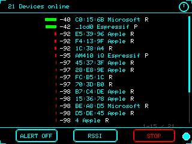

# xXCYD-BLE-BOT-SCANXx

Bluetooth awareness scanner for CYD (Cheap Yellow Display) — finds nearby BLE and Classic
devices, works out who they are, and shows them in a live device list.



## Features

- **Device naming** — advertised name first, then the IEEE OUI vendor, then the Bluetooth
  SIG company id, so even devices with a randomised MAC get identified
- **Address type badge** — `P` = public/stable, `R` = random/rotating
- **BLE scanning** — continuous active scan with RSSI signal bars
- **Classic BR/EDR** — inquiry in dual mode, 10 s every 60 s
- **Live device list** — swipe up/down to page, with scrollbar and `10-18 / 50` readout
- **Detail screen** — tap a row for MAC, vendor, class, RSSI, TX power, appearance, company id
- **Shield mode** — highlights every new/unknown device
- **SD-card logging** — one JSON line per new device in `/ble.jsonl`
- **Serial JSON capture** — `J` toggles capture, `L` toggles SD logging
- **3-button control** — ALERT toggle, SORT cycle, SCAN/STOP
- **9 theme colours** — CYAN, GREEN, RED, ORANGE, YELLOW, GRAY, PURPLE, PINK, WHITE
- **Both CYD board variants** — 1USB (ESP32-32E) and 2USB with auto-calibration
- **Deep sleep** — power ring (top-right) with touch-to-wake

## Hardware

- CYD 2.8" (ESP32 + ILI9341 display, XPT2046 touch)
- SD card for log capture
- No WiFi/internet needed — standalone scanner
- Touch navigation

## Building

```bash
# 1USB version (ESP32-32E)
pio run -e cyd_ble_bot_scan

# 2USB version
pio run -e cyd_ble_bot_scan_2usb
```

Merged firmware binaries are output to `CYD-BLE-BOT-SCAN-1usb.bin` / `CYD-BLE-BOT-SCAN-2usb.bin`.

## Flashing

1. Download the `.bin` for your board from the [latest release](../../releases/latest).
2. Copy it to the root of the SD card.
3. Flash it from the launcher on the device.

The partition table is a single 2.94 MB app (no OTA); flashing it once from an older
release rewrites the table, and NVS settings survive.

## Controls

| Control | Function |
|---|---|
| Tap a row | open the device detail screen |
| Tap anywhere (detail) | close and return to the list |
| Swipe up / down | next / previous page |
| `[ALERT OFF/ON]` | toggle shield — highlights new devices |
| `[RSSI/NAME/TYPE/NEW]` | cycle sort mode |
| `[SCAN/STOP]` | start/stop scanning |
| ● (lower-right dot) | cycle theme colour (9 colours) |

## Serial Protocol

115200 baud.

| Command | Response |
|---|---|
| `R` | `READY` |
| `S` | `RGB332:<screen data>` screenshot (320x240, one byte per pixel) |
| `J` | toggle JSON capture |
| `L` | toggle SD logging |
| `M` | cycle display MADCTL (2USB only) |
| `T` | cycle touch rotation (2USB only) |

## Screenshot helper

```bash
# Double-click, or:
python screenshot.py COM11 Screenshots\screen.bmp
```

## Docs

How it works in detail: [FEATURES.md](FEATURES.md) · what's next: [TODO.md](TODO.md).

## Credits

Built by xXQuantum-SmokeXx, with development assistance from Claude Code.

OUI lookup table and shield/alert concept adapted from [RamboRogers/esp32-bluetooth-scanner](https://github.com/RamboRogers/esp32-bluetooth-scanner) by Matthew Rogers (MIT License).